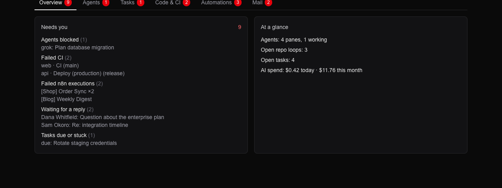

# FounderOS

A local dashboard and agent dispatcher for a solo operator who runs many projects at once. One page answers **"what needs me right now?"** across coding agents, CI, automations and mail, and a few guarded buttons act on it.

It sits on top of [Herdr](https://herdr.dev) (the terminal workspace manager for AI coding agents) and works with **Claude Code, Codex, Grok and Antigravity**. It runs on your machine only and reads every source live. There is nothing to sync and no automation workflows to maintain.



## What it shows

| Panel | Source |
|---|---|
| **Agents** | Herdr: every agent pane with its state (idle, working, blocked, done) |
| **Failed CI (7d)** | GitHub via the `gh` CLI: the newest run of each workflow and branch, across every repo in scope |
| **Failed n8n executions (3d)** | n8n REST API, grouped by workflow |
| **Open loops** | `git status` of every repo under `~/Documents`, plus tasks stuck in `running` |
| **Inbox: needs reply** | IMAP, read-only: unread, unanswered mail of the last 7 days from non-automated senders (metadata only, nothing stored) |
| **Tasks** | Baserow |
| **Agent runs** | Baserow: history, outcome and result of every dispatched run |
| **AI spend** | OpenRouter key usage (today, 7 days, month) |

The header counts everything that needs attention. `GET /api/needs-me` returns the same count as JSON (for a menu-bar badge, for example). A source that fails shows "unavailable" and never breaks the page.

## What it does

- **Alerts:** a background poller (every 3 minutes) posts only *new* items to a Discord webhook: a newly blocked agent, a failed CI run, a failed n8n execution, mail needing a reply, a task that is due or stuck. The first run only records the current state.
- **Dispatch:** a `todo` task with a repo runs headless in `claude -p`, `codex exec`, `grok -p` or `agy -p`. Agents get an edit-only permission mode (no unattended shell or network), the prompt forbids commit and push, and a run is killed after 30 minutes. The result lands in the task's Runs row, and the task moves to `review` or back to `todo`.
- **CI:** re-run failed jobs, or turn a failed run into a task carrying the failed-job log tail.
- **Mail:** compose a plain-text email to one recipient from a sender chosen in Baserow. Every attempt is logged and purged after 90 days. A task's contact address prefills the form.
- **Tasks:** add, close, reopen, reset stuck.

Every mutating endpoint accepts same-origin requests only and checks repo, agent, sender and ids against allow-lists. Every send, re-run and dispatch needs a confirm click.

## Requirements

- macOS or Linux with Node 24, `git`, and the [`gh`](https://cli.github.com) CLI logged in
- [Herdr](https://herdr.dev) running (for the Agents panel and dispatch targets)
- The agent CLIs you want to dispatch to, each already logged in
- A Baserow database with the tables below, an n8n instance with API access, and a mailbox with SMTP and IMAP

## Setup

```bash
npm install
npm run build
npx next start -H 127.0.0.1 -p 4317     # then open http://127.0.0.1:4317
```

`scripts/founderos.sh on | off | status` is the on/off switch meant for an Apple Shortcut ("Choose from Menu" with ON, OFF and Status, each running that script in a "Run Shell Script" action). ON starts `scripts/start.sh` as a detached background process and opens the browser once it answers (about 10 s), OFF stops it, and a second ON does nothing. `start.sh` runs inside an interactive zsh so credentials from your shell are available, adds `USER`, Homebrew and nvm's Node to a bare Shortcut PATH, builds and serves on localhost only. Set `FOUNDEROS_NO_OPEN=1` to skip opening the browser. Logs go to `~/Library/Logs/founderos.log`.

Shortcut setup: enable *Settings → Advanced → Allow Running Scripts* in Shortcuts, and allow Shortcuts to access the Documents folder when macOS asks (the app scans your repos). A launchd job does not work here, because macOS blocks background jobs from reading `~/Documents`.

To try the UI without any credentials, start it with `FOUNDEROS_DEMO=1`: it shows fictional data (as in the screenshot above), contacts no service, sends no alerts and writes nothing.

The app is deliberately bound to `127.0.0.1`. It reads local sessions and repos, so it should never be exposed or deployed to a hosting provider.

## Configuration

Credentials are read from the **shell environment by name**. Nothing is stored in the project and `.env*` files are never read.

| Variable | Used for |
|---|---|
| `N8N_API_URL`, `N8N_API_KEY` | failed n8n executions |
| `FOUNDEROS_BASEROW_TOKEN` | Baserow database token, scoped to the FounderOS database only |
| `FOUNDEROS_DISCORD_WEBHOOK` | alerts (unset: alerts are off, the header says so) |
| `FOUNDEROS_SMTP_HOST`, `_PORT`, `_USER`, `_PASS` | sending (port 465 is implicit TLS, anything else requires STARTTLS) |
| `FOUNDEROS_IMAP_HOST`, `_PORT`, `_USER`, `_PASS` | inbox panel (port 993 is TLS) |
| `OPENROUTER_N8N_API_KEY` | AI-spend panel |

GitHub uses your `gh` login. Dispatched agents never inherit the `FOUNDEROS_*` variables.

Repos in scope come from the filesystem (every git repo under `~/Documents`, depth ≤ 3) plus every non-archived repo of the owners listed in `src/lib/config.ts`, together with the entity mapping and the ignore list.

### Baserow schema

One database with four tables (field names matter):

| Table | Fields |
|---|---|
| `Tasks` | `title` (primary), `entity`, `repo`, `status` (todo/running/review/done), `due`, `notes`, `contact`, plus the reverse link `Runs` |
| `Runs` | `summary` (primary), `task` (link to Tasks), `agent`, `started`, `ended`, `outcome` (success/failed/blocked/cancelled), `result` |
| `Sends` | `subject` (primary), `to`, `entity`, `status` (sent/failed), `sent_at` |
| `Senders` | `address` (primary), `name`, `entity`, `project`: the allowed "From" identities, edited in Baserow |

`entity` is a single select (IndieGoWeb Ltd, Greek sole proprietorship, Personal). Table IDs are set in `src/lib/baserow.ts` and `src/lib/config.ts`.

## Layout

```
src/lib/        one adapter per source (herdr, github, git, n8n, mail, baserow, openrouter)
                dashboard.ts aggregates them, alerts.ts is the Discord poller, dispatch.ts runs agents
src/app/        the page (server component) and small client components for the buttons
src/app/api/    guarded endpoints: dispatch, tasks, tasks/status, ci/rerun, ci/fix-task, mail/send, needs-me
src/lib/demo.ts          fictional data for FOUNDEROS_DEMO=1 (screenshots, trying the UI)
src/instrumentation.ts   starts the alert poller with the server
scripts/start.sh         launcher for an Apple Shortcut
```

Next.js 16 (App Router), React 19, Tailwind 4, `nodemailer`, `imapflow`. `cacheComponents` is off on purpose: every read is live.

## Status and limitations

- Built and used on one machine; there is no test suite. It was checked by running it against live data.
- Dispatched agents are edit-only, so they cannot run tests or builds. Loosening that is a per-agent permission decision.
- If the app stops during a run, the task stays `running` and shows up as stuck.
- Alerts only fire while the app is running.
- Not built: Search Console and Analytics panels, stale-agent-session detection (Herdr exposes no idle time).
- Codex dispatch works mechanically but depends on your Codex account's usage limits.

## License

[MIT](LICENSE). This is personal tooling built around one setup: before reusing it, change the Baserow host and table IDs, the GitHub owners and entity names in `src/lib/config.ts` and `src/lib/baserow.ts`, and create the Baserow tables described above.
